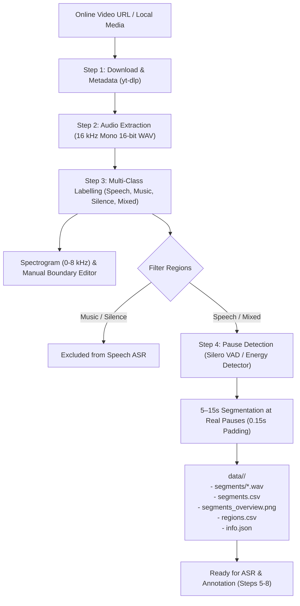

# Building a Labelled Speech Corpus: Audio Engineering Pipeline (Steps 1–4)

**Course Project:** Building a Labelled Speech Corpus from Online Videos  
**Supervisor:** Prof. Mohsen Rashwan  
**Author:** Amr Gamal ([@CaptainLevi04](https://github.com/CaptainLevi04))

---

## Overview

This repository contains the complete implementation of **Steps 1 through 4** for building an annotated speech corpus from online videos.

The pipeline handles:
1. **Step 1 — Video Ingestion & Metadata:** Downloading web videos via `yt-dlp` (optimized at 480p) and extracting video metadata (title, channel, duration, license, and Creative Commons status).
2. **Step 2 — Audio Extraction:** Converting source audio to standardized **16 kHz, mono, 16-bit PCM WAV** using `ffmpeg` (alongside lossless FLAC for listening).
3. **Step 3 — Multi-Class Region Labelling:** Classifying audio into `speech`, `music`, `mixed`, and `silence` with calibrated confidence scores (0 to 1), generating frequency-domain spectrograms (0–8 kHz), and providing interactive boundary adjustments with audit logging.
4. **Step 4 — Pause-Aware Segmentation:** Cutting `speech` and `mixed` regions into **5 to 15 second segments** strictly at natural pauses (using Silero VAD or an energy-based pause detector) with 0.15s silence padding at edges. Outputs individual WAV clips and a structured CSV index.

---

## Pipeline Architecture



---

## Repository Structure

```text
├── speech_corpus/                   # Core Python package
│   ├── __init__.py                  # Package exports
│   ├── audio.py                     # 16 kHz WAV conversion & utilities
│   ├── downloader.py                # Video download & metadata parsing
│   ├── labelling.py                 # 4-class classifier & confidence scoring
│   ├── visualization.py             # Spectrogram rendering & boundary editor
│   ├── segmentation.py              # Pause detection & 5-15s segmentation
│   ├── video_cutter.py              # Video clipping (FFmpeg & MoviePy)
│   └── pipeline.py                  # End-to-end pipeline runner
├── student1_plug_and_play.ipynb     # Interactive Jupyter Notebook
├── run_pipeline.py                  # CLI runner script
├── requirements.txt                 # Dependencies
├── setup.py                         # Package installation setup
└── README.md
```

---

## Installation

### Prerequisites
* Python 3.9+
* FFmpeg installed on system PATH:
  * **Windows:** `winget install ffmpeg`
  * **Linux / Colab:** `sudo apt update && sudo apt install -y ffmpeg`
  * **macOS:** `brew install ffmpeg`

### Setup
```bash
git clone https://github.com/CaptainLevi04/Audio-Datasets-Creation-System.git
cd Audio-Datasets-Creation-System
pip install -r requirements.txt
```

---

## Usage

### 1. Interactive Notebook (Google Colab / Local Jupyter)
Open [`student1_plug_and_play.ipynb`](student1_plug_and_play.ipynb):
* Set `MODE = "DEMO"` for an instant self-contained test on synthetic multi-class audio (finishes in 5 seconds without internet or GPU).
* Set `MODE = "REAL"` to run on a YouTube URL or local file.

### 2. Command Line Interface (CLI)

```bash
# Fast offline demonstration (zero download, runs immediately):
python run_pipeline.py --demo

# Process a YouTube video (downloads at 480p to conserve bandwidth):
python run_pipeline.py --url "https://www.youtube.com/watch?v=VIDEO_ID" --out-dir data

# Process a local video or audio file:
python run_pipeline.py --file "my_video.mp4" --out-dir data

# Cut matching video clips alongside audio WAVs:
python run_pipeline.py --url "https://www.youtube.com/watch?v=VIDEO_ID" --cut-video
```

---

## Output Structure

Running the pipeline on a video generates an isolated output directory:

```text
data/<video_id>/
├── video.mp4                 # Downloaded video file
├── audio.wav                 # 16 kHz mono 16-bit PCM WAV
├── audio_hq.flac             # Lossless copy for human listening
├── info.json                 # Metadata (title, duration, CC license)
├── regions.csv               # Step 3 regions (start, end, label, confidence)
├── regions_edits.csv         # Audit log of manual human overrides
├── regions_spectrogram.png   # Full audio spectrogram with classification overlay
├── segments_overview.png     # Spectrogram showing the first 20 cut segments labeled
├── segments/                 # Cut 5-15s audio segments
│   ├── segment_0001.wav
│   ├── segment_0002.wav
│   └── ...
└── segments.csv              # Master index table for downstream steps
```

### `segments.csv` Schema

| Column | Type | Description |
| :--- | :--- | :--- |
| `segment_id` | string | `0001`, `0002`, ... |
| `wav_file` | string | Relative path to segment audio file |
| `start` | float | Start timestamp in seconds |
| `end` | float | End timestamp in seconds |
| `duration` | float | Segment duration (strictly within 5.0 to 15.0 s) |
| `source_region_label`| string | `speech` or `mixed` |
| `confidence` | float | Step 3 classification confidence (0 to 1) |
| `cut_type` | string | `natural_region`, `pause_optimal`, etc. |
| `snr_db` | float | *(Placeholder for Step 5 SNR)* |
| `clean_noisy` | string | *(Placeholder for Step 5 Quality)* |
| `transcript_whisper` | string | *(Placeholder for Step 6 Whisper)* |
| `transcript_mms` | string | *(Placeholder for Step 6 MMS)* |
| `status` | string | `pending_asr` |
