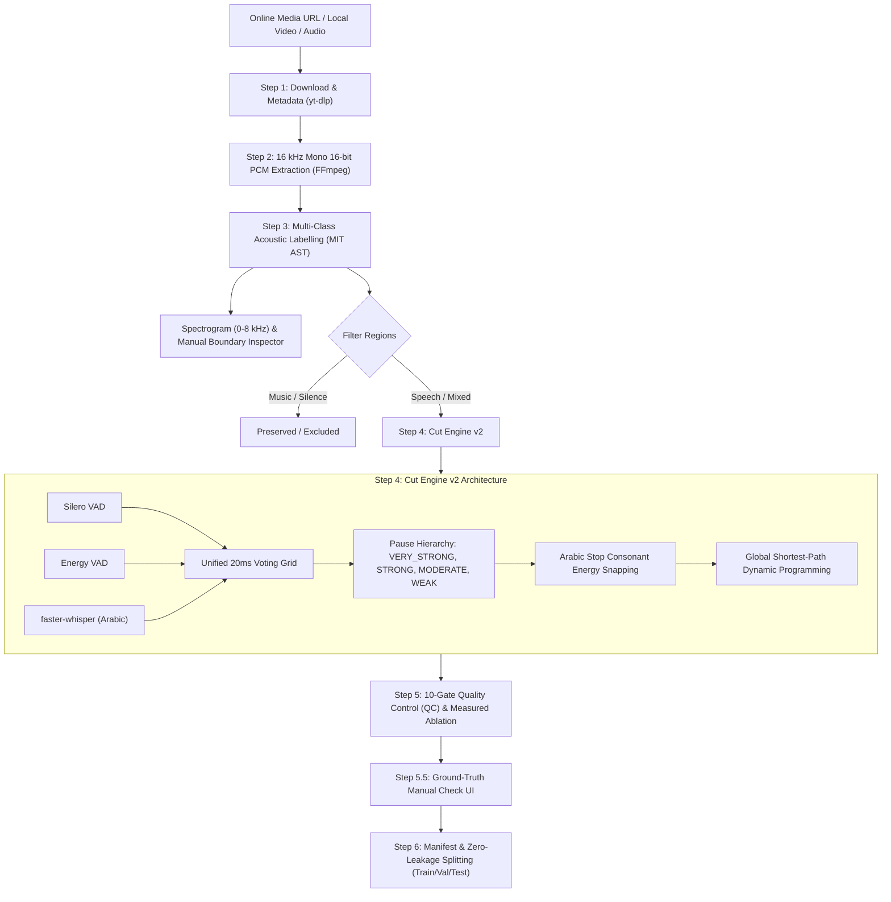

# Audio Datasets Creation System: Production Audio Engineering Pipeline

**Course Project:** Building a Labelled Speech Corpus from Online Media  
**Supervisor:** Prof. Mohsen Rashwan  
**Author:** Amr Gamal ([@CaptainLevi04](https://github.com/CaptainLevi04))  
**Specification:** Version 2.2 (Unified Multi-Detector Voting, Cut Engine v2 Global DP & 10-Gate QC)

---

## 🚀 Overview

This repository provides an end-to-end, industrial-grade audio preprocessing and corpus creation pipeline designed for speech processing, Automatic Speech Recognition (ASR), and Machine Learning dataset creation.

The system ingests arbitrary online videos or local audio files, converts and standardizes signals to broadcast-grade specifications, performs deep acoustic event detection, applies multi-detector pause voting with Arabic phoneme-safe boundary alignment, solves optimal segmentation globally via Dynamic Programming (DP), and validates every output against 10 strict Quality Control (QC) integrity gates.

### Pipeline Capabilities:
1. **Step 1 — Ingestion & Metadata:** Downloads web videos via `yt-dlp` (bandwidth-optimized at 480p) and extracts complete provenance metadata (title, channel, duration, license, and Creative Commons status).
2. **Step 2 — Audio Extraction & Normalization:** Converts audio to broadcast standard **16 kHz, mono, 16-bit PCM WAV** using `ffmpeg` (alongside lossless FLAC for human perceptual evaluation).
3. **Step 3 — Multi-Class Audio Labelling (MIT AST):** Employs the Audio Spectrogram Transformer (AST) to segment and classify the entire audio into 4 canonical classes: `speech`, `music`, `mixed`, and `silence` with calibrated posterior probabilities, 0–8 kHz spectrogram rendering, and interactive boundary fine-tuning.
4. **Step 4 — Cut Engine v2 (Unified Voting Grid & Global DP Optimizer):**
   - **Unified Voting Grid (20ms bins):** Silero VAD + Energy VAD + faster-whisper Arabic word boundaries.
   - **Four-Tier Pause Hierarchy:** `VERY_STRONG` (3/3 agreement), `STRONG` (2/3), `MODERATE` (1/3), and `WEAK` (fallbacks).
   - **Phonemic Safety:** Arabic stop consonant snapping (`ب`, `ت`, `ط`, `د`, `ض`, `ق`, `ك`) with energy closure valley searches.
   - **Global Shortest-Path DP:** Minimizes deviation from the 10-second target duration while strictly enforcing 5–15s priority limits (15–18s fallback), 100–200ms silence margins, and Hann cross-fades.
5. **Step 5 — 10-Gate QC Verification & Measured Ablation:** Real, countable compliance tests verifying no segment overlaps, margin compliance, duration boundaries, and output audio health, alongside empirical Greedy Baseline vs. Global DP ablation tracking.
6. **Step 5.5 — Interactive Review Queue & Ground-Truth Manual Check:** Rich Jupyter UI allowing human annotators to audit both Labelling and Segmentation with 2 review scopes (Flagged vs. Full Video) and instant feedback logging.
7. **Step 6 — Corpus Manifest & Zero-Leakage Dataset Splitting:** Automated creation of `video_summary.csv`, aggregated `corpus_manifest.csv`, and stratified cross-video splits (70% Train, 15% Val, 15% Test).

---

## 📐 Pipeline Architecture



---

## 📁 Repository Structure

```text
├── speech_corpus/                       # Core modular Python package
│   ├── __init__.py                      # Package exports
│   ├── ast_model.py                     # MIT Audio Spectrogram Transformer architecture
│   ├── audio.py                         # 16 kHz WAV conversion & signal utilities
│   ├── cut_engine_v2.py                 # Cut Engine v2 (DP optimizer, pauses, Arabic stops)
│   ├── downloader.py                    # yt-dlp video downloading & metadata extraction
│   ├── inspector.py                     # Interactive ipywidgets inspectors & Review Queue
│   ├── labelling.py                     # Multi-class labelling & calibrated confidence scoring
│   ├── pipeline.py                      # End-to-end pipeline orchestrator
│   ├── quality_control.py               # 10 mandatory QC integrity gates & ablation tracking
│   ├── segmentation.py                  # Unified Voting Grid & candidate extraction
│   ├── video_cutter.py                  # Synchronized FFmpeg/MoviePy video clip generator
│   └── visualization.py                 # 0-8 kHz spectrogram generator & overlays
├── tests/                               # Verification test suite
│   ├── test_inspector_fixes.py          # UI & Ground-Truth Manual Check tests
│   ├── test_targeted_revisions.py       # Comprehensive Specification v2.2 suite
│   └── test_whisper_voting_fix.py       # Whisper voting absence unit test
├── docs/                                # Project documentation
│   └── Course_Project_Specification.pdf # Official course specifications
├── student1_v14.ipynb                   # Production interactive Jupyter Notebook
├── student1_standalone.ipynb           # Single-file standalone Jupyter Notebook
├── student1_colab_standalone.ipynb      # Google Colab standalone Notebook
├── student1_standalone.py               # Single-file standalone Python pipeline
├── run_pipeline.py                      # Modular CLI runner
├── train_ast_finetune.py                # AST model fine-tuning script
├── labels.json                          # Class label mapping index
├── requirements.txt                     # Dependencies
├── setup.py                             # Package installation configuration
└── README.md
```

---

## 🛠️ Installation

### 1. Prerequisites
* **Python:** 3.9, 3.10, or 3.11
* **FFmpeg:** Installed and available on system PATH
  * **Windows:** `winget install Gyan.FFmpeg` or `choco install ffmpeg`
  * **Ubuntu / Debian:** `sudo apt update && sudo apt install -y ffmpeg`
  * **macOS:** `brew install ffmpeg`

### 2. Setup Repository
```bash
git clone https://github.com/CaptainLevi04/Audio-Datasets-Creation-System.git
cd Audio-Datasets-Creation-System
pip install -r requirements.txt
```

---

## 💻 How to Run

### 1. Interactive Jupyter Notebook (Recommended for Research & Annotation)
Launch Jupyter and open [`student1_v14.ipynb`](student1_v14.ipynb):
* Includes all 13 pipeline steps.
* Features interactive audio playback, spectrogram editors, segment review queues, and the Ground-Truth Manual Check UI.

### 2. Google Colab (Zero-Setup Cloud Execution)
Open [`student1_colab_standalone.ipynb`](student1_colab_standalone.ipynb) in Google Colab:
* Supports one-click GPU acceleration for AST classification and Whisper word boundary detection.

### 3. Command Line Interface (CLI)

```bash
# Run self-contained offline demonstration (synthetic audio, finishes in seconds):
python run_pipeline.py --demo

# Process a YouTube video end-to-end:
python run_pipeline.py --url "https://www.youtube.com/watch?v=VIDEO_ID" --out-dir data

# Process a local video or audio file:
python run_pipeline.py --file "path/to/media.mp4" --out-dir data

# Synchronously cut matching video clips alongside audio segments:
python run_pipeline.py --url "https://www.youtube.com/watch?v=VIDEO_ID" --cut-video
```

### 4. Standalone Python Script
For headless server environments where no external modular package imports are desired:
```bash
python student1_standalone.py
```

---

## 📊 Verification & Tests

To execute the automated test suite:
```bash
python -m unittest tests/test_whisper_voting_fix.py
python -m unittest tests/test_inspector_fixes.py
python -m unittest tests/test_targeted_revisions.py
```

---

## 📋 Output Directory Structure

Each processed media generates an isolated, self-documenting artifact directory:

```text
data/<video_id>/
├── video.mp4                 # Downloaded source video (480p)
├── audio.wav                 # 16 kHz mono 16-bit PCM WAV (Standard Master)
├── audio_hq.flac             # Lossless copy for human auditing
├── info.json                 # Metadata (title, duration, CC license)
├── regions.csv               # 4-class classification intervals
├── regions_edits.csv         # Audit log of manual human overrides
├── regions_spectrogram.png   # Full-audio spectrogram with classification overlay
├── pauses.csv                # Detected silence pause candidates & agreement tiers
├── ablation_metrics.json     # Measured Greedy Baseline vs. Global DP ablation stats
├── qc_report.md              # 10-Gate Quality Control Markdown Report
├── manual_check.csv          # Ground-Truth manual check results & error annotations
├── video_summary.csv         # Duration breakdown by audio class
├── segments_overview.png     # Visual segmentation map
└── segments/                 # Cut 5–15s audio clips (100–200ms margins)
    ├── segment_0001.wav
    ├── segment_0002.wav
    └── ...
```

---

## 📜 License

This project is licensed under the MIT License. See [LICENSE](LICENSE) for details.
